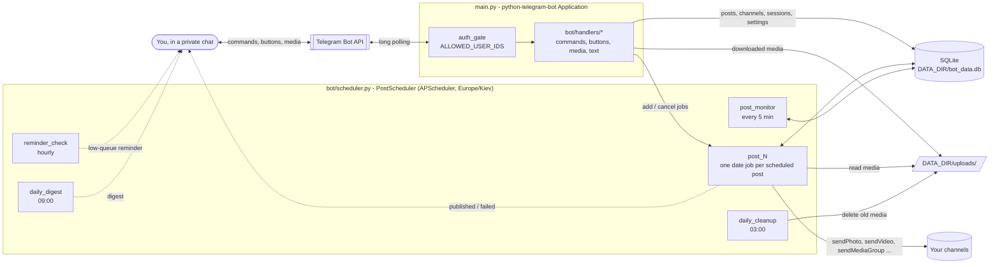
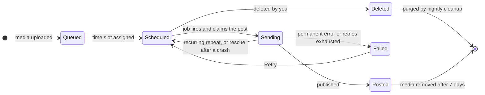

<div align="center">

# 📅 Telegram Channel Post Scheduler

**A self-hosted Telegram bot that queues, schedules and publishes photos, videos, albums and documents to your channels: one-off, in bulk, or on repeat.**

[](https://github.com/uasneppy/telegramscheduler/actions/workflows/ci.yml)


[Features](#-features) · [How it works](#-how-it-works) · [Getting started](#-getting-started) · [Configuration](#%EF%B8%8F-configuration) · [Usage](#-usage) · [FAQ](#-troubleshooting--faq)

</div>

---

You send media to the bot in a private chat. It stores the files, lines them up in a queue and publishes them to your channels on a schedule you control: inside a daily posting window, from a custom start date, or as recurring posts. Everything happens through a button-driven menu in Telegram. There is no web panel and no external service beyond the Telegram Bot API.

It's built for channel admins and small content teams who prepare posts in batches, run several channels, and want to keep the bot and its data on their own server. One deployment can serve several people: each allowed user gets their own channels, queue, settings and backups.

## 📖 Table of contents

- [Features](#-features)
- [How it works](#-how-it-works)
- [Tech stack](#-tech-stack)
- [Getting started](#-getting-started)
- [Configuration](#%EF%B8%8F-configuration)
- [Usage](#-usage)
- [Data & security model](#-data--security-model)
- [Project structure](#-project-structure)
- [Development](#-development)
- [Troubleshooting & FAQ](#-troubleshooting--faq)
- [Contributing](#-contributing)

## ✨ Features

**Uploading**
- **Three upload modes:** *Bulk upload* (media only), *With captions* (each file's own caption), and *Guided captioning* (upload everything first, then caption each item while seeing a preview).
- **Albums:** up to 10 photos/videos sent as one Telegram album, with a single caption. Available in *With captions* mode.
- **Media types:** photos, videos, audio, GIFs and documents. Images and videos sent *as files* are published as documents, so the original quality is kept.
- **Native formatting:** bold, italics, links and custom emoji in captions are stored as Telegram entities and published unchanged. This applies to *With captions*, *Guided captioning* and caption edits in *Edit posts*.
- **Per-user storage quota** (2 GB by default) so one user can't fill the server disk.

**Scheduling**
- A **daily posting window and interval** (default 10:00–20:00, every 2 h), set in three taps with an hour picker.
- **Schedule all** (starting tomorrow), **next available slot** (continues after your last scheduled post) or a **custom start date** with a fixed interval.
- **🔀 Shuffle** the queue before scheduling, or shuffle the times of **already-scheduled** posts within each channel.
- **Reschedule all** pending posts from today, **bulk-redistribute** scheduled posts over a new window, or move a single post (+1 h … +2 days, a custom time, or "post next" in 1 minute).
- **Recurring posts:** daily, weekly, every few days, or any custom interval from 1 to 168 h. They can stop after *N* posts, on a date, or never.
- **Multi-channel batches:** named batches per channel that you fill and schedule separately or all at once.

**Channels**
- Unlimited channels per user. To connect one, **forward any post from it** (or type its `@username` / `-100…` ID).
- On registration the bot **checks that you are an admin** of the channel and sends a **self-deleting test post** to prove it can publish.
- **Caption signatures** per channel: text appended to every caption, such as a channel link, hashtags or a subscribe line.

**Reliability**
- Jobs are rebuilt from the database on startup. Posts that came due while the bot was offline go out a few seconds after it starts.
- An atomic `pending → sending` claim prevents double posting. Posts stuck mid-send are rescued automatically.
- Automatic retries with error diagnosis: rate limits, network errors, a missing admin right, a wrong chat ID, oversized files, invalid captions.
- A watchdog runs every 5 minutes. It recreates missing jobs and catches overdue posts.

**Notifications & insight**
- A **live dashboard** in `/start`: channel, queue and schedule counts, the next post, and alert buttons for failed or overdue posts.
- **Notification modes:** every post, a daily digest at 09:00, or errors only. A **low-queue reminder** fires when your unscheduled queue runs low.
- **Calendar** (month, week and day views), **post previews**, **statistics** and **`/status`** health info.
- **Named backups** of your pending posts, with replace/add restore.
- Optional **error reports to an admin chat**.

## 🧭 How it works



1. **Access control.** Every update first goes through `auth_gate`, which rejects users outside `ALLOWED_USER_IDS` before any handler runs.
2. **Conversation state.** Multi-step flows (uploading, typing a date, naming a batch …) are tracked per user in the `user_sessions` table, so a restart doesn't lose your place.
3. **Upload.** Media is downloaded to `DATA_DIR/uploads/` and recorded as a *queued* post: `pending`, with no time yet.
4. **Schedule.** Assigning times stores them in the database (Kyiv-time ISO strings) and creates one APScheduler `DateTrigger` job per post.
5. **Publish.** When a job fires, the post is claimed (`pending → sending`). The bot re-checks that you still own the channel, appends the channel signature (only if the caption stays within 1024 characters), sends the media, and marks the post `posted`. Recurring posts are re-armed instead.
6. **Housekeeping.** The 5-minute monitor rescues stuck or overdue posts. The 03:00 job deletes published media older than 7 days and purges deleted posts.

### Post lifecycle



| State | `posts.status` | Meaning |
|---|---|---|
| Queued | `pending`, `scheduled_time` empty | Uploaded, waiting for a time slot |
| Scheduled | `pending`, `scheduled_time` set | Has a time and an APScheduler job |
| Sending | `sending` | Claimed by a job; reset to `pending` if stuck for over 30 min or at startup |
| Posted | `posted` | Published (or a recurring post that reached its end condition) |
| Failed | `failed` | Gave up; the reason is stored in `failure_reason` |
| Deleted | `deleted` | Soft-deleted; removed with its media by the 03:00 cleanup |

<details>
<summary><b>Publishing and retry rules</b></summary>

- Each send makes up to **3 retries**.
  - Rate limits wait the `retry after` value Telegram returns, plus 1 s.
  - Network errors wait 10 s, and unrecognized Telegram errors wait 5 s.
  - Non-Telegram exceptions back off 2 → 4 → 8 s.
- **Permanent errors fail at once**, with a diagnosis sent to you: bot blocked or not an admin (`Forbidden`), `chat not found`, file too large, bad request or invalid caption.
- Jobs that fire late still run within a **1-hour misfire grace period**.
- **At startup**, posts that came due while the bot was down are sent about 15 s after launch, 3 s apart.
- **The monitor** (every 5 min):
  - resets posts stuck in `sending` for more than 30 min;
  - re-creates missing jobs for future posts;
  - re-queues overdue posts 10 s out. A post that keeps getting re-queued without being sent is marked `failed` after 5 attempts.
- Albums go out with `sendMediaGroup` (max 10 items). The caption is attached to the first item.

</details>

## 🧰 Tech stack

| Layer | Technology |
|---|---|
| Language | Python 3.11 (Docker image `python:3.11-slim`; `requires-python >= 3.11`) |
| Telegram | [python-telegram-bot](https://github.com/python-telegram-bot/python-telegram-bot) 20.8 (async, long polling, HTTPX with 50-connection pool and 5-minute read/write timeouts) |
| Scheduling | [APScheduler](https://github.com/agronholm/apscheduler) 3.11 `AsyncIOScheduler`, timezone `Europe/Kiev` |
| Storage | SQLite (stdlib `sqlite3`, WAL mode, foreign keys on) and media files on local disk |
| Timezones | `pytz` (+ `tzdata` in the Docker image) |
| Tests / CI | pytest, GitHub Actions (compile check, tests, Docker build) |
| Deployment | Docker and Docker Compose, or plain `python main.py` |

> [!NOTE]
> The Docker image, CI and `uv.lock` all use **python-telegram-bot 20.8**. `requirements.txt` currently pins `python-telegram-bot==22.3` (plus `Pillow` and `aiofiles`, which the code never imports). The commands below install the 20.8 stack that CI tests.

## 🚀 Getting started

### Prerequisites

- A Telegram account and at least one channel you administer.
- **Docker with Compose v2** *or* **Python 3.11+**.
- Your numeric Telegram user ID, for the allowlist. You can get it from a bot such as [@userinfobot](https://t.me/userinfobot).

### 1. Create the bot

1. Open [@BotFather](https://t.me/BotFather) and send `/newbot`.
2. Choose a display name and a username ending in `bot`.
3. Copy the **token** (it looks like `123456789:AA...`) and keep it secret.

### 2. Make the bot a channel admin

In each channel: **Channel info → Administrators → Add Admin →** your bot, and grant **Post messages**.

### 3a. Run with Docker (recommended)

```bash
git clone https://github.com/uasneppy/telegramscheduler.git
cd telegramscheduler
cp .env.example .env        # then set BOT_TOKEN and ALLOWED_USER_IDS
docker compose up -d --build
docker compose logs -f bot  # watch it start
```

The database and uploaded media persist in `./data` on the host, which is mounted at `/data` in the container. The container restarts automatically (`restart: unless-stopped`).

### 3b. Run natively

```bash
git clone https://github.com/uasneppy/telegramscheduler.git
cd telegramscheduler
python3.11 -m venv .venv && source .venv/bin/activate
pip install "python-telegram-bot==20.8" "apscheduler>=3.11.0" "pytz>=2025.2" "tzdata>=2025.2"

export BOT_TOKEN="123456789:AA...your-token..."
export ALLOWED_USER_IDS="123456789"
export DATA_DIR="$PWD/data"   # the default /data usually isn't writable outside Docker
python main.py
```

> [!TIP]
> The bot does **not** read `.env` by itself. That file is only for Docker Compose. To reuse it for a native run, load it into your shell first: `set -a; source .env; set +a`.

### 4. Connect your first channel

1. Open your bot in Telegram and send `/start`.
2. Tap **➕ Add my first channel**.
3. **Forward any post from the channel** to the bot, or send its `@username` (public) or `-100…` ID (private).
4. The bot calls `getChatMember` to confirm that **you** are an administrator or the creator. Then it sends and deletes a test message to confirm **it** can post.
5. You're ready. Tap **📤 Start uploading**.

## ⚙️ Configuration

All configuration comes from environment variables, which are read in [`config.py`](config.py).

| Variable | Required | Default | Description |
|---|---|---|---|
| `BOT_TOKEN` | **yes** | — | Bot token from @BotFather. Docker Compose refuses to start without it. |
| `ALLOWED_USER_IDS` | strongly recommended | *(empty)* | Comma-separated numeric Telegram user IDs allowed to use the bot, e.g. `123456789,987654321`. **If empty, anyone who finds the bot can use it** (a warning is logged at startup). A non-numeric entry stops startup with an error. |
| `ADMIN_CHAT_ID` | no | *(unset)* | Chat (e.g. your own user ID) that receives the last 1,500 characters of the traceback for any unhandled error. When unset, errors only go to the log. |
| `DATA_DIR` | no | `/data` | Directory for `bot_data.db` and `uploads/`. The Dockerfile sets it to `/data`. Set it to a writable path when running natively. |
| `MAX_USER_STORAGE_MB` | no | `2048` | Per-user quota for stored media, in MB. `0` = unlimited. A non-integer value falls back to `2048`. |
| `TELEGRAM_CHANNEL_ID` | no | *(unset)* | Legacy. `config.py` still reads it, but nothing uses it: channels are managed per user via `/channels`. |

`docker-compose.yml` passes `BOT_TOKEN`, `ALLOWED_USER_IDS`, `ADMIN_CHAT_ID` and `MAX_USER_STORAGE_MB` from `.env` into the container.

<details>
<summary><b>Built-in constants (edit the code to change)</b></summary>

| Setting | Value | Where |
|---|---|---|
| Timezone for all times (input, display, scheduling) | `Europe/Kiev` | `config.TIMEZONE` |
| Default daily window and interval for new users | 10:00–20:00, every 2 h | `config.DEFAULT_START_HOUR / DEFAULT_END_HOUR / DEFAULT_INTERVAL_HOURS` |
| Bot-side file-size limit | none (Telegram's limits apply) | `config.MAX_FILE_SIZE` |
| Misfire grace for late jobs | 3600 s | `bot/scheduler.py` (`MISFIRE_GRACE_SECONDS`) |
| Published-media retention | 7 days | `bot/utils.py` (`cleanup_old_media_files`) |
| Job times | cleanup 03:00, digest 09:00, reminders hourly, monitor every 5 min | `PostScheduler.start()` |
| Caption signature limit | 300 characters | `bot/handlers/channels.py` |

</details>

## 💬 Usage

Almost everything is reachable from the **`/start` dashboard**. Commands exist for power users. Telegram's command menu (the `/` button) lists eight everyday commands, marked ★ below.

### Main menu

| Button | What it does |
|---|---|
| 📤 **Bulk upload** | Pick a channel, then send any number of media files. A single status message updates as files arrive and offers **Schedule now · Shuffle · Preview · Discard all**. |
| 📝 **With captions** | Pick a channel, then send media with a caption on each message. Formatting is preserved. Send several photos/videos as an album, then send its caption as a text message. |
| 🎯 **Guided captioning** | Upload everything and tap **Done Uploading**. The bot then shows each item and asks for its caption (or **Skip**), then offers scheduling. |
| 📦 **Batches** | Multi-channel batch scheduler (same as `/multibatch`). |
| 🔄 **Recurring posts** | Create a post that repeats on an interval. |
| ♻️ **Manage recurring** | Per channel: preview, edit the caption, interval or end condition, or delete recurring posts. |
| ⚠️ **N failed** / ⏰ **N overdue** | Alert rows. They appear only when something needs attention. |
| 👁 **Preview** | Browse pending posts per channel, have the bot send you the actual media, edit the caption, delete. |
| 📅 **Calendar** | Month grid with post counts per day, day details, *Today* and *This Week* views. |
| ✏️ **Edit posts** | Per channel, step through pending posts created in *With captions* mode: preview, edit caption, replace media, reschedule, **post next (in 1 min)**, delete. |
| 🔁 **Reschedule all** | Re-plan all pending posts from today, using the default 10–20 / 2 h or custom hours. Channels are interleaved. |
| 🔀 **Shuffle scheduled** | Randomly swap the times of your upcoming scheduled posts *within each channel*. Overdue posts stay where they are. Needs at least 2 future posts in a channel. |
| 📺 **Channels** | List, add or remove channels, and edit **caption signatures**. |
| 📊 **Statistics** | Queued, scheduled, posted and failed counts, per-channel breakdown and the next posts. |
| ⚙️ **Settings** | Low-queue reminders (on/off, threshold 1–50) and the notification mode. |

### Scheduling options

These open from **Schedule now**, `/schedule`, or the end of guided captioning.

| Option | Behaviour |
|---|---|
| ✅ **Schedule All Posts** | Puts every queued post (all channels, one shared timeline) into your daily window, **starting tomorrow**. |
| ⏭️ **Next Available Slot** | Continues after your latest scheduled post, or uses the next free slot today if nothing is scheduled. |
| 🔀 **Shuffle order** | Randomizes which queued post lands in which slot. |
| ⚙️ **Change Settings** | Tap the first hour, then the end hour, then the interval (1, 2, 3, 4, 6, 8 or 12 h). You can also type all three at once, e.g. `10 20 2`. That example gives slots at 10, 12, 14, 16 and 18 every day: the end hour is exclusive. |
| 📅 **Custom Date** | Type `YYYY-MM-DD HH:MM interval_hours`, e.g. `2026-11-01 10:00 3`. Posts go every *N* hours from that moment. The start time must fall inside your daily window. |
| 🔄 **Recurring Schedule** | Turns the queued posts into recurring posts. |

### Commands

| Command | Description |
|---|---|
| `/start` ★ | Main menu and live dashboard. Shows onboarding if you have no channels yet. |
| `/mode1` ★ | Bulk upload (pick a channel, then send media). |
| `/mode2` ★ | Upload with captions (and albums). |
| `/schedule` ★ | Scheduling options for your queued posts. |
| `/stats` ★ | Posting statistics. |
| `/settings` ★ | Reminders and notification mode. |
| `/cancel` ★ | Abort the current flow and clear your **unscheduled** queue. Scheduled posts stay. |
| `/help` ★ | Help with topic buttons. |
| `/channels` | Manage channels and caption signatures. |
| `/multibatch` | Multi-channel batch scheduler. |
| `/finish` | Finish uploading to a batch (or end a *With captions* session). |
| `/preview` | Browse pending posts with media previews. |
| `/editposts` | Edit pending captioned posts per channel. |
| `/edit_captions` | Step through a channel's scheduled posts and rewrite captions. |
| `/bulkedit` | Redistribute scheduled posts (all, by upload mode, or by channel) over a new window: `start end [interval] [YYYY-MM-DD]`, e.g. `10 20 2 2026-11-01`. |
| `/overdue` | List overdue posts. Reschedule them to the next slots, or post them now. |
| `/retry` | Retry failed posts: one, all, or by channel. |
| `/clearqueue` | Delete all unscheduled posts and their media (asks for confirmation). |
| `/clearscheduled` | Delete scheduled posts and their media, all at once or per channel (asks for confirmation). |
| `/delete_all_captions` | Remove the captions from all your posts (asks for confirmation). |
| `/recover_interactive` | List pending posts that have no caption. |
| `/recover_captions` | Explains why automatic caption recovery is disabled (bots can't read chat history). |
| `/backup` | Create, list or delete named backups of your pending posts. |
| `/restore` | Restore a backup, replacing or adding to the current posts. |
| `/status` | Uptime, scheduler job count, database size, free disk, your storage usage and post counts. |
| `/reset` | Delete all your posts, channels, scheduling settings and session state (asks for confirmation). |
| `/recurring` | Registered, but currently fails when typed (see [Known limitations](#known-limitations)). Use **🔄 Recurring posts** in `/start` instead. |

### Walkthroughs

<details open>
<summary><b>Schedule a pile of photos</b></summary>

1. `/start` → **📤 Bulk upload** → pick a channel.
2. Send your media one by one, or several at once. In this mode an album becomes separate posts, one per item. Send images and videos as files to keep the original quality.
3. Tap **📅 Schedule now**. Optionally tap **🔀 Shuffle** first.
4. Pick **✅ Schedule All Posts**, **⏭️ Next Available Slot**, or set a new window with **⚙️ Change Settings**.
5. You'll get a per-day summary, e.g. `Mon 02.11: 10:00 · 12:00 · 14:00`. In *Every post* notification mode, the bot also confirms each publication.

> Starting a mode for a channel discards that mode's **unscheduled** leftovers for that channel from a previous session. Scheduled posts are never touched.

</details>

<details>
<summary><b>Create a recurring post</b></summary>

1. `/start` → **🔄 Recurring posts** → pick a channel.
2. Send **one** media file, then a description (or `skip`).
3. Choose the interval: **Daily**, **Every 3 Days**, **Weekly** or **Custom** (1–168 h).
4. Choose the end condition: **after X posts** (1–1000), **on a date** (e.g. `2026-12-31 18:00`) or **never**.
5. Choose when the first post goes out: **in 1 minute**, **in 1 hour**, **today 18:00**, **tomorrow 10:00**, or a custom `YYYY-MM-DD HH:MM`.
6. After each publication, the next run is scheduled *interval* hours later. Edit or stop it under **♻️ Manage recurring**.

</details>

<details>
<summary><b>Fill several channels with batches</b></summary>

1. `/start` → **📦 Batches** → **Create New Batch** → pick a channel → send a name (1–50 characters, unique per user).
2. Choose **Mode 1 (Bulk)** or **Mode 2 (Descriptions)**. In Mode 2 the bot asks for a description after each file; reply `skip` for none.
3. Send media, then `/finish`.
4. Tap **Schedule This Batch**, or later **Schedule All Batches**. That hands out consecutive slots from one shared timeline in your daily window, starting tomorrow, so batches never collide.

> ⚠️ **Schedule All Batches** also clears your regular unscheduled queue in every channel (see [Known limitations](#known-limitations)). Schedule or discard that queue first.

</details>

<details>
<summary><b>Shuffle</b></summary>

- **Before scheduling:** **🔀 Shuffle** (on the bulk-upload status message) or **🔀 Shuffle order** (in scheduling options) randomizes the queue order. The time slots stay the same; the posts that fill them change.
- **After scheduling:** **🔀 Shuffle scheduled** on the dashboard swaps times among your upcoming posts. Posts stay in their own channel, so each channel keeps its slot pattern. The scheduler jobs are updated immediately.

</details>

<details>
<summary><b>Back up and restore your schedule</b></summary>

1. `/backup` (needs at least one scheduled post) → **Create New Backup** → send a name (max 50 characters; reusing a name overwrites that backup).
   The backup is a JSON snapshot of all your **pending** posts (queued and scheduled), stored in the `post_backups` table.
2. `/restore` → pick a backup → choose:
   - **Replace**: deletes all your current pending posts first. **Add**: keeps them.
   - **+ Include Missing Files**: also restores posts whose media file is gone, marked as `failed`. Without it, those posts are skipped.
3. Posts for channels you no longer own are skipped. The 5-minute monitor picks up the restored posts and schedules them. Any that are already overdue are sent shortly.

> Backups store post **metadata and file paths, not the media itself**. Album bundles and caption formatting entities are not included. To protect against disk loss, also back up `DATA_DIR` (see [Data & security model](#-data--security-model)).

</details>

### Notifications

| Mode (in `/settings`) | You receive |
|---|---|
| 📣 Every post *(default)* | A message for every published post |
| 📮 Daily digest | A 09:00 summary of posts published in the last 24 h and currently failed posts. A review button is included when something failed. |
| 🔕 Errors only | Only failure messages |

**Failure alerts are sent in every mode.** Most carry **🔄 Retry now · ✏️ Manage posts · 🏠 Menu** buttons. Separately, the **low-queue reminder** (checked hourly, at most once a day) tells you when your unscheduled queue drops to the threshold or below.

## 🔐 Data & security model

### Where data lives

```text
$DATA_DIR/                     # /data in Docker (./data on the host via compose)
├── bot_data.db                # SQLite database, WAL mode (+ bot_data.db-wal / -shm)
└── uploads/
    └── YYYY-MM/DD/<user_id>/<media_type>/<uuid>.<ext>
```

- All timestamps are stored as **Kyiv-time ISO-8601 strings** (`2026-11-02T10:00:00+02:00`). At startup a one-time migration converts rows written in older formats.
- The schema is created and migrated in place on every start (`CREATE TABLE IF NOT EXISTS` plus additive `ALTER TABLE`), so upgrades need no manual steps.
- **Media cleanup:** the 03:00 job deletes the media file of posts published more than 7 days ago, and hard-deletes soft-deleted posts with their files. Clearing your queue or scheduled posts deletes their files immediately.
- To back up the server, stop the bot and copy the whole `DATA_DIR`, including the `-wal`/`-shm` files.

<details>
<summary><b>Database tables</b></summary>

| Table | Contents |
|---|---|
| `posts` | Every post: owner, channel, file path or album bundle (JSON), caption and formatting entities, status, scheduled time, recurring settings, retry info, failure reason, batch, shuffle order |
| `user_channels` | Each user's channels: ID, display name, active flag, caption signature |
| `scheduling_config` | Per-user daily window and interval, reminder settings, notification mode |
| `user_sessions` | Current conversation step and scratch data per user |
| `post_batches` | Named per-channel batches |
| `post_backups` | Named backups (JSON snapshot of pending posts) |
| `schema_meta` | Markers for one-time data migrations |

</details>

### Who can use the bot

- **Allowlist.** When `ALLOWED_USER_IDS` is set, an `auth_gate` handler registered in group `-1` runs before every other handler. Updates from anyone else are answered with *"⛔ You are not authorized"* and dropped. **When it is empty, the bot is open to every Telegram user**, so always set it for real deployments.
- **Channel ownership.** You can only register a channel where you are an **administrator or creator**, as verified through `getChatMember`. This stops anyone from posting through the bot to channels where the bot happens to be an admin.

### Per-user isolation

- Every post, channel, batch, setting, session and backup row is keyed by Telegram user ID. Handlers and SQL queries filter by the acting user.
- Callback data can be forged, so post, batch and channel IDs that arrive through buttons are re-checked for ownership before any change is made.
- Channel ownership is checked again **when a post is created** and **right before every send**. Removing a channel from your list makes its pending posts fail instead of publishing.
- Restoring a backup re-checks channel ownership, and the storage quota applies per user.

### Secrets

- The token comes only from the environment. `.env` is excluded from git and from the Docker build context.
- HTTPX request logging is lowered to `WARNING`, so request URLs containing the bot token never reach the logs.

## 🗂 Project structure

```text
telegramscheduler/
├── main.py                   # Entry point: logging, DB init, auth gate, handler registration, polling
├── config.py                 # Environment variables, paths, timezone, default window, conversation states
├── bot/
│   ├── database.py           # SQLite schema, migrations and every query (Database class)
│   ├── scheduler.py          # PostScheduler: jobs, publishing, retries, monitor, digest, reminders, cleanup
│   ├── utils.py              # Kyiv-time helpers, schedule maths, media storage and quota, formatting
│   ├── caption_recovery.py   # /recover_captions and /recover_interactive
│   └── handlers/
│       ├── __init__.py       # Merges all handler modules into one shared namespace
│       ├── common.py         # Shared imports and constants
│       ├── dispatch.py       # Router for every inline-button callback
│       ├── menu.py           # /start dashboard, /help, /stats, /status
│       ├── uploads.py        # /mode1, /mode2, guided-captioning uploads, albums, /finish
│       ├── scheduling.py     # /schedule, hour picker, custom dates, calendar, /bulkedit, /overdue, shuffle
│       ├── recurring.py      # Recurring post setup and management
│       ├── batches.py        # /multibatch
│       ├── channels.py       # /channels, verification and test post, signatures, per-channel views
│       ├── editing.py        # /editposts, /edit_captions, /preview, guided-captioning steps
│       └── misc.py           # Text-input router, /cancel, /clearqueue, /reset, /retry, /backup, /restore, /settings
├── tests/                    # pytest suite: database, datetime, schedule maths, quota, UI builders
├── .github/workflows/ci.yml  # Compile check, pytest and Docker build
├── Dockerfile                # python:3.11-slim, DATA_DIR=/data volume
├── docker-compose.yml        # Single "bot" service, ./data mounted at /data
├── .env.example              # Template for docker compose
├── pyproject.toml, uv.lock   # Project metadata and locked dependencies (python-telegram-bot 20.8)
├── requirements.txt          # Alternative pin list (see the note under Tech stack)
└── replit.md                 # Legacy Replit notes and changelog (historical)
```

## 🛠 Development

Run the same steps as CI:

```bash
python3.11 -m venv .venv && source .venv/bin/activate
pip install "python-telegram-bot==20.8" "apscheduler>=3.11.0" "pytz>=2025.2" pytest

python -m compileall -q main.py config.py bot/   # compile check
pytest tests/ -q                                 # 42 tests, no network needed
docker build -t telegram-scheduler:dev .         # image build
```

- `tests/conftest.py` points `DATA_DIR` at a temporary directory and creates a fresh database for every test, so tests never touch real data or Telegram.
- CI ([`.github/workflows/ci.yml`](.github/workflows/ci.yml)) runs the compile check and tests on Python 3.11 and builds the Docker image. It triggers on every push to `main` and on every pull request.
- No linter or formatter is configured. The compile check is the only static gate.
- **Adding a feature.** Register a command in `main.py` and implement it in the matching `bot/handlers/*` module. For a new button, add its `callback_data` prefix to `bot/handlers/dispatch.py`. Handler modules share one namespace (see `bot/handlers/__init__.py`), so they can call each other without imports. New code should still prefer explicit imports.

## 🩺 Troubleshooting & FAQ

<details>
<summary><b>"⛔ You are not authorized to use this bot."</b></summary>

Your user ID isn't in `ALLOWED_USER_IDS`. Add it (comma-separated, numbers only) and restart the bot.
</details>

<details>
<summary><b>"Could not verify the channel" / "You must be an administrator"</b></summary>

Three things must all be true: the bot is an admin of the channel, **you** are an admin or the creator, and the ID is correct. Public channels can use `@username`; private ones need the `-100…` ID. Forwarding a post from the channel avoids typing the ID altogether.
</details>

<details>
<summary><b>"Channel added, but the test post failed"</b></summary>

The bot is in the channel but lacks the **Post messages** right. Fix that in the channel's admin settings, otherwise scheduled posts will fail.
</details>

<details>
<summary><b>Posts fail with "Forbidden", "bot was blocked" or "chat not found"</b></summary>

The bot was removed from the channel, lost its admin rights, or the channel ID changed. Re-add the bot as an admin, then use **⚠️ N failed → Retry** or `/retry`. Retried posts return to `pending`, and the 5-minute monitor picks them up again.
</details>

<details>
<summary><b>Large files fail to upload</b></summary>

The bot uses the standard cloud Bot API, which lets bots download files up to **20 MB** and upload up to **50 MB**. Your per-user quota (`MAX_USER_STORAGE_MB`) also applies. `/status` shows your current usage.
</details>

<details>
<summary><b><code>PermissionError: '/data'</code> when running natively</b></summary>

`DATA_DIR` defaults to `/data` for Docker. Set it to a writable directory, e.g. `export DATA_DIR="$PWD/data"`.
</details>

<details>
<summary><b>Which timezone are times in?</b></summary>

All times you type and see are **Kyiv time** (`Europe/Kiev`), including across DST changes. To use a different zone, change `TIMEZONE` in `config.py`.
</details>

<details>
<summary><b>What happens if the bot is offline at a scheduled time?</b></summary>

Nothing is lost. On restart, overdue posts are sent about 15 s after launch, 3 s apart, and the monitor catches anything it misses. You can also handle them yourself via **⏰ N overdue** or `/overdue`.
</details>

<details>
<summary><b>Can two people post to the same channel?</b></summary>

Yes. Each allowed user registers the channel separately (both must be channel admins). Each one's queue, schedule and settings stay separate.
</details>

### Known limitations

- Typing `/recurring` fails because its handler expects a button press. Use **🔄 Recurring posts** in `/start`.
- **Schedule All Batches** clears your whole unscheduled queue, in every channel, after scheduling the batches.
- Changing the daily window (**⚙️ Change Settings** or typed `10 20 2`) resets your reminder and notification settings to their defaults.
- Album media files are not removed by the 7-day cleanup.
- `/reset` leaves your uploaded media files on disk, and your backups and batches in the database.
- Backups don't include album bundles or caption formatting entities.

## 🤝 Contributing

Issues and pull requests are welcome.

1. Fork the repo and create a branch.
2. Keep changes focused, and add or extend tests in `tests/` where possible.
3. Run the compile check and `pytest tests/ -q` locally.
4. Open a PR. CI must pass.

Never commit tokens, `.env` files, databases or uploaded media. `.gitignore` already excludes them.
